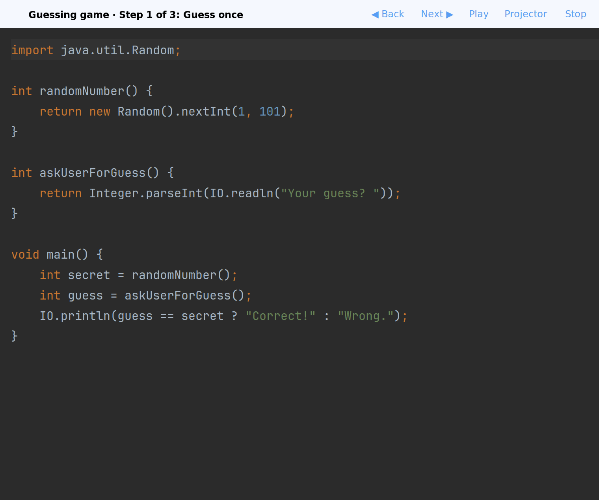
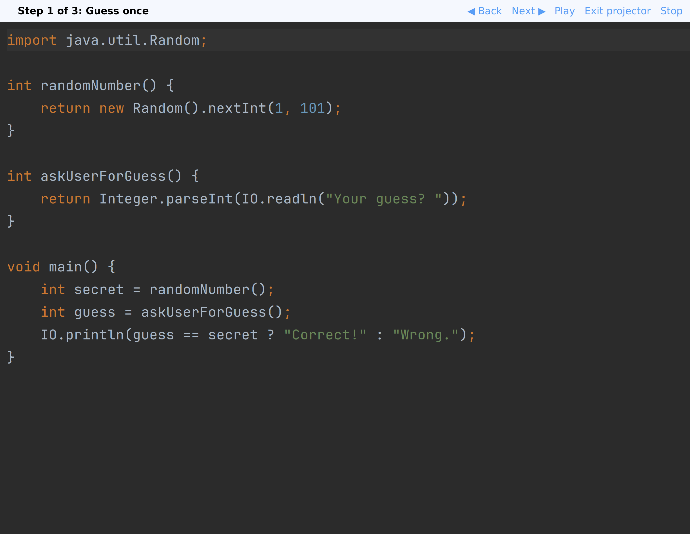
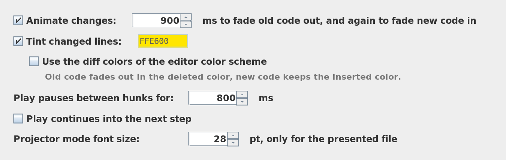
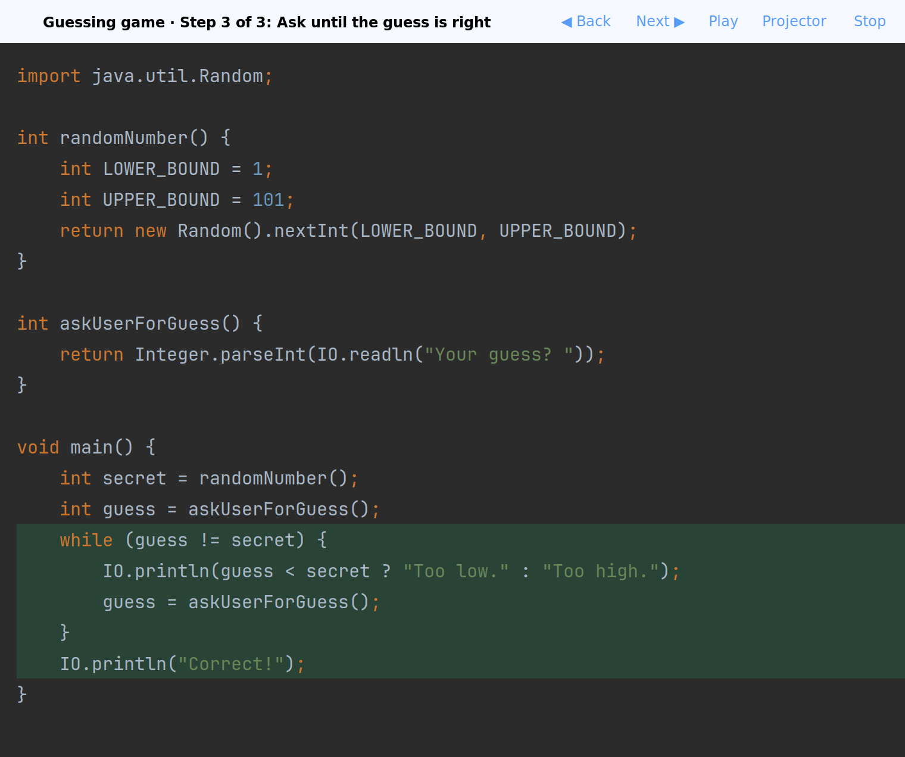

# Code Steps

[](https://github.com/raphaelluethy/code-steps/actions/workflows/build.yml)
[](https://github.com/raphaelluethy/code-steps/releases/latest)
[](LICENSE)

An IntelliJ Platform plugin for presenting code step by step, like slides, or for playing a recorded refactoring
back chunk by chunk, as if someone were editing live in front of the class. You save several versions of a file
as steps. Each change between two steps is split into diff hunks (blocks of contiguous changed lines), and the
hunks play one at a time, top to bottom, in the normal editor.



## Teaching with Code Steps

Prepare a lesson by recording a working example as you develop it. Capture a step at each point you want to
discuss, such as naming a constant, adding a loop, or extracting a method. Give the steps useful titles in
`presentation.yaml`, then commit `.codesteps/` alongside the example so students and colleagues can replay it.

In class, open the example and start its presentation. Advance one hunk, explain the change, and ask students
to predict the next one. Go back to revisit an idea, or use Play to walk through a longer change. Turn on
Projector for larger text and fewer distractions.

Unlike slides, the lesson stays in a real source file with the IDE's syntax highlighting and navigation.
Unlike live typing, the prepared changes need no typing or typo recovery during the explanation. You can
still edit the example to answer a question, and Stop restores the file's original content.

## Features

- **Any file type.** Stepping, diffing, highlighting, and animation work on the document text only, so Kotlin,
  Markdown, YAML, and plain text all behave the same. No language plugin or PSI is needed.
- **A real editor.** Each step replaces the content of the file's regular editor, so syntax highlighting,
  navigation, completion, and inspections keep working while you present.
- **Plain files in Git.** Presentations live in `.codesteps/` inside the project. Commit them, review them in
  pull requests, and share them by cloning the repository.
- **Hunk-by-hunk playback.** Animated word and line changes, Back, Next, and Play let you control the pace.
- **Classroom display.** Projector mode enlarges the editor and banner. Choose a custom tint or the editor
  color scheme's diff colors to mark changes.
- **Record while editing.** Capture steps explicitly or through commits made in the IDE.

## Installation

1. Download `code-steps-0.2.3.zip` from the [GitHub release](https://github.com/raphaelluethy/code-steps/releases/tag/v0.2.3).
   Use the plugin ZIP under **Assets**, not GitHub's source-code archives. Do not unzip it.
2. In a [compatible IDE](#compatibility), open **Settings | Plugins | ⚙ | Install Plugin from Disk**.
3. Select the ZIP and restart the IDE if prompted.

The GitHub release ZIP is the installation route documented here; you do not need to build from source.

## Quick start

After installation, there is nothing to configure.

1. Open a project and a source file you want to teach from. Save any work before presenting.
2. Right-click in the editor and choose **Start Recording**. The file as it is now becomes step 1,
   and a red banner shows that recording is on.
3. Edit as usual. Whenever you reach a point the audience should see, choose **Capture Step**, or commit in the
   IDE: each commit that includes the file adds a step named after the commit message.
4. Click **Stop recording** in the banner, then **Start presentation** in the notification.
5. Click **Next ▶** in the banner above the editor to show one change at a time.

A step can hold many separate edits; playback splits it into hunks, so capturing coarse steps is fine.
Without a recording, **Capture Step** adds the current content to the file's presentation and creates it on first
use. You can also write the files yourself (see [File format](#file-format)).

## Presenting

**Start Presentation** is under **Tools | Code Steps**. The file shows step 1, and a banner above the editor shows the position (step, and hunk
within the change to the next step) with **◀ Back**, **Next ▶**, **Play**, **Projector**, and **Stop**.


| Action | Windows / Linux | What it does |
| --- | --- | --- |
| Next hunk (**Next ▶**) | `Ctrl+Alt+Shift+]` | Shows the next hunk: the old code goes, the new code comes. |
| Previous hunk (**◀ Back**) | `Ctrl+Alt+Shift+[` | Takes back the last hunk. |
| Play / Pause | `Ctrl+Alt+Shift+Space` | Plays the hunks of the step one at a time with a pause between them. Pause lets the current hunk finish. |
| Next step | `Ctrl+Alt+Shift+.` | Plays the rest of the step hunk by hunk; press again to complete it at once. |
| Previous step | `Ctrl+Alt+Shift+,` | Goes back to the start of the step, or to the previous step. |

On macOS, Next and Previous step are `⌘⌥⇧.` and `⌘⌥⇧,`. Change or add shortcuts under
**Settings | Keymap | Plugins | Code Steps**. **Stop** puts back the content the file had before you started.

A change looks like an edit made by hand, without the typing, and is as small as the edit: in a changed line only
the words that differ go and come, while a block that was rewritten is replaced as a whole. The old code is selected, in the editor's selection
color, and fades out. The space it took slides open or closed to fit the new code, so the code below moves to its
new place and never jumps. Then the new code fades in. Changed words and lines keep a soft tint until the next step; the
text keeps its syntax colors. Removed code leaves no mark.

The editor keeps the active hunk centered. While presenting you can type freely; **Save Editor to Current Step**
overwrites the current step, and **Capture Step** inserts the editor content as a new step after it.

**Projector** enlarges the presented editor (28 pt by default), hides the tool windows, the folding outline and
the intention bulbs, and enlarges the banner so it reads from the back of the room. Turning it off or stopping the
presentation restores everything.



## Recording

Recording saves snapshots of one file, not a video or a keystroke history.

1. Open the file and choose **Start Recording** from its editor context menu or **Tools | Code Steps**.
   The current content becomes the first step.
2. Edit the file. Choose **Capture Step** at each teaching point. While recording, a commit made in the IDE
   that includes the file also captures a step, titled with the first nonblank line of the commit message.
   Commits made in a terminal do not trigger this integration.
3. Choose **Stop recording** in the red banner. This captures any final changes and offers to start presenting.

Unchanged content does not add another recorded step. A recording belongs to one file, so repeat the process
for another file if the lesson needs it. To revise a lesson, edit the snapshot files and manifest directly,
or present it and use **Save Editor to Current Step** or **Capture Step**.

## Settings

**Settings | Tools | Code Steps** holds the personal preferences, stored in the IDE configuration and not in the
project:

- **Animate changes** and how long a fade takes (900 ms). Off, each change appears at once.
- **Tint changed lines** and the tint color (yellow).
- **Use the diff colors of the editor color scheme** instead of the tint: old code fades out in the
  deleted color, and new code keeps the inserted color.
- How long Play pauses between hunks (800 ms, doubled after a finished step).
- Whether Play continues into the next step.
- The projector mode font size.



With diff colors enabled, inserted code uses the editor color scheme's inserted color instead of yellow.
During animation, removed code uses its deleted color before disappearing.



## File format

```
.codesteps/
  tokenizer/
    presentation.yaml
    01-skeleton.kt
    02-read-numbers.kt
    03-read-operators.kt
```

`presentation.yaml` lists the steps in order. `target` is relative to the project root:

```yaml
# Code Steps presentation. Each step file is a complete snapshot of the target file;
# steps are shown in the order listed below.
codesteps: 1
title: "Tokenizer.kt"
target: "src/main/kotlin/Tokenizer.kt"
steps:
  - file: "01-skeleton.kt"
    title: "Skeleton"
  - file: "02-read-numbers.kt"
    title: "Read numbers"
```

Each step file is a complete copy of the target file at that step and keeps the target's extension, so it opens with
syntax highlighting and a pull request shows each step as an ordinary file. To see what one step changes, diff two
step files. You can write or edit everything by hand: reorder steps by moving their entries, and rename step files as
long as the manifest matches. The manifest is a small YAML subset: one `key: value` per line, values plain or quoted.
`codesteps` is the format version; the plugin refuses a presentation with a version newer than it knows.

The plugin excludes `.codesteps/` from indexing, so step files do not show up as duplicate classes in navigation or
search. They are still regular files in version control.

## Compatibility

Version 0.2.3 targets IntelliJ IDEA 2026.3 and requires IntelliJ Platform build **263 or newer**.
The plugin declares no upper build limit, but that does not guarantee compatibility with future IDE releases.
The [Build workflow](https://github.com/raphaelluethy/code-steps/actions/workflows/build.yml) runs JetBrains
Plugin Verifier against the recommended IDE versions.

The plugin depends on the IntelliJ Platform, not a particular language plugin. Other IntelliJ-based IDEs
must meet the same platform requirement; check the verifier results for tested versions. IDE commit capture
uses the optional VCS integration. Manual capture and playback do not require it.

## Building

Requires JDK 25 (IntelliJ IDEA 2026.3 runs on Java 25).

```bash
./gradlew test          # unit and platform tests
./gradlew buildPlugin   # build/distributions/code-steps-<version>.zip
./gradlew runIde        # start a sandbox IDE with the plugin installed
./gradlew verifyPlugin  # check compatibility with IntelliJ Platform Plugin Verifier
```

Install the ZIP with **Settings | Plugins | ⚙ | Install Plugin from Disk**.

See [image regeneration](docs/images/README.md) for the headless README capture commands.

## License

Code Steps is licensed under the [GNU General Public License v3.0](LICENSE). See [CHANGELOG.md](CHANGELOG.md)
for release history.
